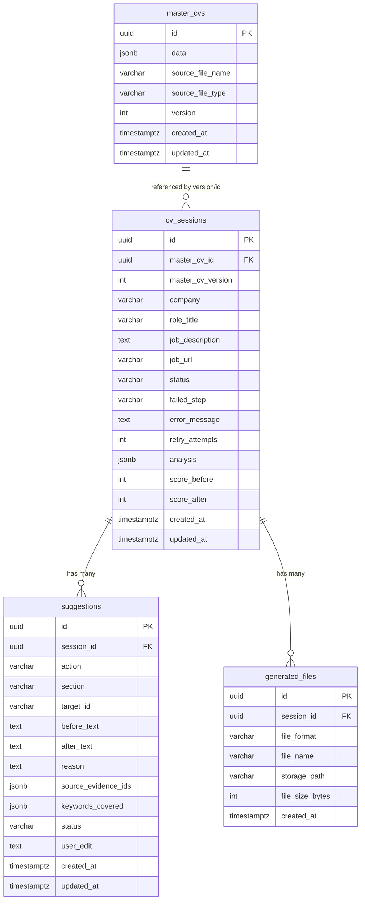

# Database Schema & Migration Specification (Neon Postgres)

Este documento detalla la estructura exacta de las tablas, columnas, tipos de datos PostgreSQL/SQLModel, restricciones y relaciones que se migrarán a Neon mediante Alembic.

---

## 1. Resumen de Tablas

1. `master_cvs`: Almacena las versiones del CV base del usuario (en JSON estructurado).
2. `cv_sessions`: Ciclo de vida completo de cada sesión de adaptación a un Job Description específico.
3. `suggestions`: Propuestas atómicas de cambio generadas por el Agente 2 (Advisor) para una sesión.
4. `generated_files`: Registro de archivos físicos finales creados (.docx / .pdf).

---

## 2. Diagrama de Relaciones (ERD)

---

## 3. Especificación Detallada por Tabla

### 3.1 Tabla: `master_cvs`
Guarda el CV madre estructurado en JSON después de ser analizado por el parser.

| Columna | Tipo PostgreSQL | Tipo SQLModel / Python | Nulo | Default / Restricciones | Descripción |
|---|---|---|:---:|---|---|
| `id` | `UUID` | `uuid.UUID` | No | `gen_random_uuid()` / PK | Identificador único del CV madre |
| `data` | `JSONB` | `dict` (Pydantic `MasterCV`) | No | — | Árbol completo del CV (contacto, experiencia, educación, skills, etc.) |
| `source_file_name`| `VARCHAR(255)` | `str` | Sí | `NULL` | Nombre original del archivo subido (ej: `cv_carlos.docx`) |
| `source_file_type`| `VARCHAR(10)` | `str` | Sí | `NULL` | Tipo de archivo (`docx` o `pdf`) |
| `version` | `INTEGER` | `int` | No | `1` | Versión incremental cada vez que el usuario edita su CV base |
| `created_at` | `TIMESTAMPTZ` | `datetime` | No | `now()` | Fecha y hora de creación |
| `updated_at` | `TIMESTAMPTZ` | `datetime` | No | `now()` | Fecha y hora de última modificación |

**Índices:**
- `ix_master_cvs_version` en `(version)`

---

### 3.2 Tabla: `cv_sessions`
Representa una corrida/postulación a un puesto de trabajo. Gestiona la máquina de estados.

| Columna | Tipo PostgreSQL | Tipo SQLModel / Python | Nulo | Default / Restricciones | Descripción |
|---|---|---|:---:|---|---|
| `id` | `UUID` | `uuid.UUID` | No | `gen_random_uuid()` / PK | Identificador único de la sesión |
| `master_cv_id` | `UUID` | `uuid.UUID` | Sí | FK -> `master_cvs.id` ON DELETE SET NULL | ID del CV madre usado como base |
| `master_cv_version`| `INTEGER` | `int` | No | `1` | Versión congelada del CV madre usada en esta postulación |
| `company` | `VARCHAR(150)` | `str` | Sí | `NULL` | Nombre de la empresa extraído del JD o escrito por el usuario |
| `role_title` | `VARCHAR(150)` | `str` | Sí | `NULL` | Título del puesto (ej: `Senior Backend Engineer`) |
| `job_description` | `TEXT` | `str` | No | — | Texto completo de la vacante pegado por el usuario |
| `job_url` | `VARCHAR(500)` | `str` | Sí | `NULL` | Enlace opcional de la publicación (LinkedIn, etc.) |
| `status` | `VARCHAR(50)` | `str` (Enum) | No | `'DRAFT'` | Estado actual del flujo (ver lista de estados abajo) |
| `failed_step` | `VARCHAR(50)` | `str` | Sí | `NULL` | Nombre del paso que falló (`ANALYSIS`, `SUGGESTION`, `GENERATION`) |
| `error_message` | `TEXT` | `str` | Sí | `NULL` | Mensaje descriptivo o código de error en caso de fallo |
| `retry_attempts` | `INTEGER` | `int` | No | `0` | Contador de reintentos ejecutados en el paso actual |
| `analysis` | `JSONB` | `dict` (Pydantic `JobAnalysis`) | Sí | `NULL` | Resultado del Agente 1 (keywords, matched, gaps, seniority) |
| `score_before` | `INTEGER` | `int` | Sí | `NULL` | Match score inicial (0-100) calculado por el Agente 1 |
| `score_after` | `INTEGER` | `int` | Sí | `NULL` | Match score final (0-100) tras aplicar los cambios aprobados |
| `created_at` | `TIMESTAMPTZ` | `datetime` | No | `now()` | Fecha y hora de inicio de la sesión |
| `updated_at` | `TIMESTAMPTZ` | `datetime` | No | `now()` | Fecha y hora de última actualización |

**Estados posibles (`status`):**
- `DRAFT`
- `ANALYZING`
- `ANALYZED`
- `SUGGESTING`
- `AWAITING_APPROVAL`
- `GENERATING`
- `COMPLETED`
- `ANALYSIS_FAILED`
- `SUGGESTION_FAILED`
- `GENERATION_FAILED`

**Índices:**
- `ix_cv_sessions_status` en `(status)`
- `ix_cv_sessions_created_at` en `(created_at DESC)`

---

### 3.3 Tabla: `suggestions`
Registra cada una de las recomendaciones puntuales que el Agente 2 sugiere modificar en el CV.

| Columna | Tipo PostgreSQL | Tipo SQLModel / Python | Nulo | Default / Restricciones | Descripción |
|---|---|---|:---:|---|---|
| `id` | `UUID` | `uuid.UUID` | No | `gen_random_uuid()` / PK | Identificador único de la sugerencia |
| `session_id` | `UUID` | `uuid.UUID` | No | FK -> `cv_sessions.id` ON DELETE CASCADE | Sesión a la que pertenece |
| `action` | `VARCHAR(20)` | `str` (Enum) | No | — | Acción propuesta: `ADD`, `REMOVE`, `REWRITE`, `REORDER` |
| `section` | `VARCHAR(50)` | `str` | No | — | Sección afectada: `experience`, `skills`, `summary`, etc. |
| `target_id` | `VARCHAR(100)` | `str` | No | — | ID exacto del nodo en el `MasterCV` (ej: `exp_1_b3`) |
| `before_text` | `TEXT` | `str` | Sí | `NULL` | Texto original (en caso de `REWRITE` o `REMOVE`) |
| `after_text` | `TEXT` | `str` | Sí | `NULL` | Texto propuesto por el Agente 2 |
| `reason` | `TEXT` | `str` | No | — | Justificación ATS de por qué conviene hacer el cambio |
| `source_evidence_ids` | `JSONB` | `list[str]` | No | `'[]'` | Lista de IDs del CV madre que respaldan que el usuario sí sabe esto |
| `keywords_covered` | `JSONB` | `list[str]` | No | `'[]'` | Palabras clave del JD que este cambio cubre |
| `status` | `VARCHAR(20)` | `str` (Enum) | No | `'PENDING'` | Decisión humana: `PENDING`, `APPROVED`, `REJECTED`, `EDITED` |
| `user_edit` | `TEXT` | `str` | Sí | `NULL` | Texto personalizado final en caso de que el usuario lo haya editado a mano |
| `created_at` | `TIMESTAMPTZ` | `datetime` | No | `now()` | Fecha de creación |
| `updated_at` | `TIMESTAMPTZ` | `datetime` | No | `now()` | Fecha de última decisión humana |

**Índices:**
- `ix_suggestions_session_id` en `(session_id)`
- `ix_suggestions_status` en `(status)`

---

### 3.4 Tabla: `generated_files`
Control de los documentos generados guardados en almacenamiento local (`data/files/`).

| Columna | Tipo PostgreSQL | Tipo SQLModel / Python | Nulo | Default / Restricciones | Descripción |
|---|---|---|:---:|---|---|
| `id` | `UUID` | `uuid.UUID` | No | `gen_random_uuid()` / PK | Identificador único del archivo |
| `session_id` | `UUID` | `uuid.UUID` | No | FK -> `cv_sessions.id` ON DELETE CASCADE | Sesión que originó el archivo |
| `file_format` | `VARCHAR(10)` | `str` | No | — | Formato del archivo (`docx` o `pdf`) |
| `file_name` | `VARCHAR(255)` | `str` | No | — | Nombre legible (ej: `Carlos_Dandte_Google_Backend_Engineer.docx`) |
| `storage_path` | `VARCHAR(500)` | `str` | No | — | Ruta relativa o absoluta en disco (`data/files/...`) |
| `file_size_bytes` | `INTEGER` | `int` | Sí | `NULL` | Tamaño en bytes para validar integridad |
| `created_at` | `TIMESTAMPTZ` | `datetime` | No | `now()` | Fecha de generación |

**Índices:**
- `ix_generated_files_session_id` en `(session_id)`

