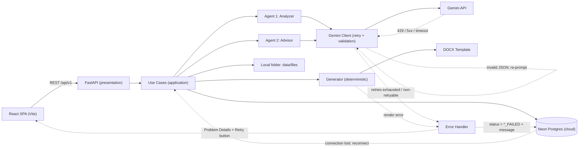
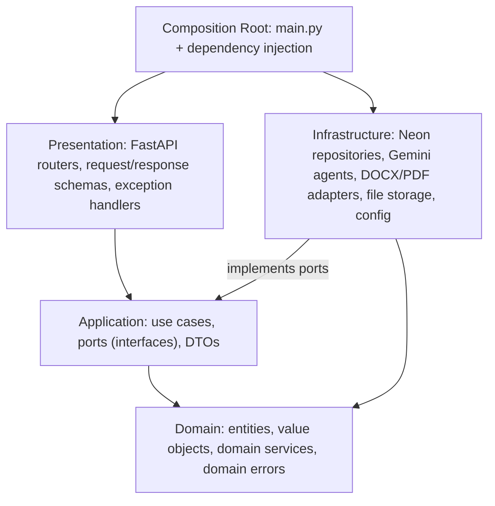
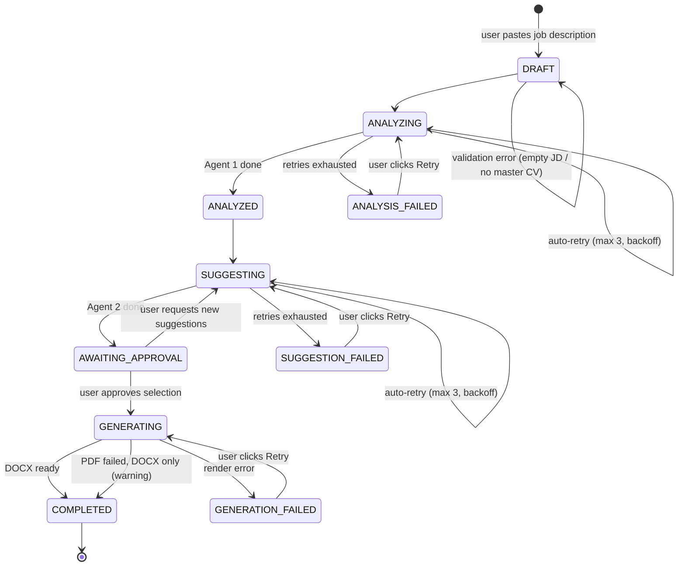
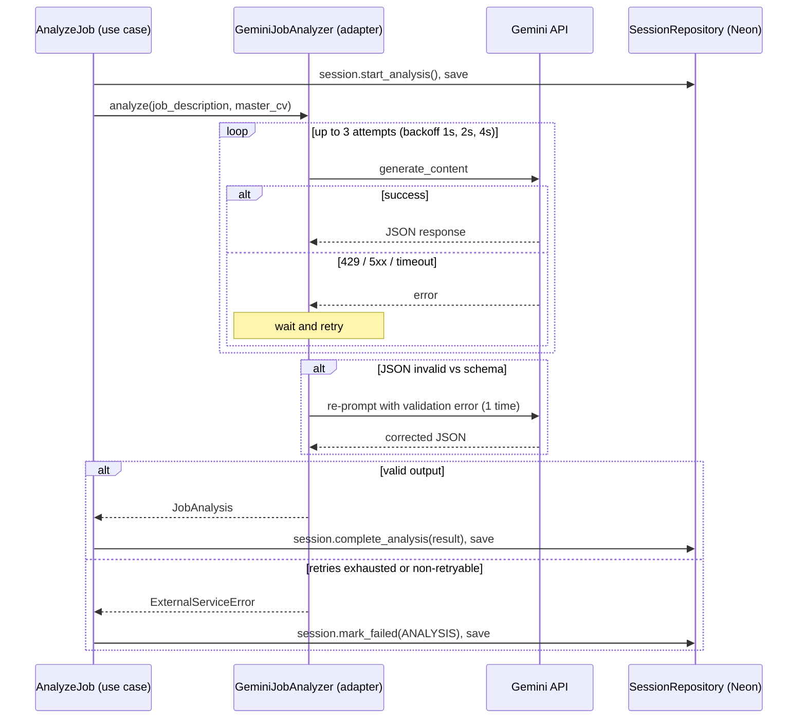
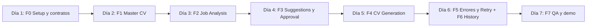

# Implementation Plan — Search-Jobs Platform · Tool: **Create CV**

> [!IMPORTANT]
> **Decisiones confirmadas:**
> 1. Stack: **React 19 + Vite + TypeScript (SPA)** en el frontend y **FastAPI/Python** en el backend, ambos con **Clean Architecture**.
> 2. LLM: **Gemini únicamente**, vía SDK oficial `google-genai` con *structured output* (`response_schema`). API key en `.env` (`GEMINI_API_KEY`), modelo configurable (`GEMINI_MODEL`).
> 3. App corre **local, single-user** (sin login). Base de datos: **Neon (Postgres serverless)** vía `DATABASE_URL`; archivos (.docx/.pdf) en disco local.
> 4. CV madre: se acepta **.docx y .pdf** (se recomienda .docx porque se parsea más limpio); la IA lo convierte a **JSON estructurado** y lo revisas/editas una vez.
> 5. Toda la UI, prompts, código y outputs en **inglés**.

> [!NOTE]
> **¿Por qué React y no Angular?** Para un MVP de 1 semana con 2 devs apoyados por IA, React + Vite es más ligero (menos boilerplate), tiene el ecosistema más grande (shadcn/ui, TanStack Query) y es donde las herramientas de IA generan código más confiable. Angular es una opción válida y más "opinada" (DI y módulos nativos) si el equipo ya lo domina; la estructura Clean Architecture de este plan aplica igual.

> [!TIP]
> **Gemini API key:** se obtiene en **Google AI Studio → https://aistudio.google.com/apikey** (botón *Create API key*). Docs: https://ai.google.dev/gemini-api/docs
>
> **Neon:** crear proyecto en **https://console.neon.tech** → copiar el *connection string* (pooled) → pegarlo en `.env` como `DATABASE_URL`. Docs: https://neon.tech/docs

> [!NOTE]
> **¿Por qué no vectores/RAG en el MVP?** El CV madre (~1–3k tokens) cabe completo en el contexto de Gemini, y los agentes necesitan leerlo **entero** para comparar contra el job description. Se guarda como **JSON (`JSONB`)** y se envía completo en cada sesión. Neon soporta **`pgvector`**, así que si en el futuro se agrega un "achievement bank", búsqueda semántica de historial o recomendación de empleos, se habilita sin migrar de base de datos.

---

## 1. Arquitectura general



> Líneas punteadas = rutas de error / reintento.

**Principio clave:** los agentes razonan y devuelven **JSON validado (Pydantic)**; el documento final lo genera **código determinista** sobre una plantilla ATS-friendly.

---

## 2. Clean Architecture

### 2.1 Regla de dependencia

Las dependencias **siempre apuntan hacia adentro**. El dominio no conoce FastAPI, Neon, Gemini ni React; la infraestructura implementa las interfaces (*ports*) que define la capa de aplicación.



| Capa | Responsabilidad | Puede depender de | Ejemplos |
|---|---|---|---|
| **Domain** | Reglas de negocio puras, sin I/O | nada (solo stdlib / Pydantic) | `MasterCV`, `CVSession` (máquina de estados), `Suggestion`, `CVTailor`, `MatchScorer`, `EvidenceValidator` |
| **Application** | Orquesta casos de uso; define *ports* | Domain | `AnalyzeJob`, `GenerateSuggestions`, `GenerateTailoredCV`, `RetrySession`; ports `JobAnalyzer`, `SessionRepository` |
| **Infrastructure** | Implementa ports con tecnología concreta | Application, Domain | `GeminiJobAnalyzer`, `SqlSessionRepository`, `DocxTemplateRenderer`, `LocalFileStorage` |
| **Presentation** | HTTP: validar input, llamar use case, mapear output/errores | Application | Routers FastAPI, schemas de request/response, handlers RFC 7807 |

### 2.2 Ports & Adapters

| Port (application) | Adapter (infrastructure) | Propósito |
|---|---|---|
| `TextExtractor` | `DocxTextExtractor`, `PdfTextExtractor` | Sacar texto del CV subido |
| `CVParser` | `GeminiCVParser` | Texto → `MasterCV` |
| `JobAnalyzer` | `GeminiJobAnalyzer` | Agent 1 |
| `SuggestionAdvisor` | `GeminiSuggestionAdvisor` | Agent 2 |
| `DocumentRenderer` | `DocxTemplateRenderer` | `TailoredCV` → .docx |
| `PdfExporter` | `LibreOfficePdfExporter` | .docx → .pdf (stretch) |
| `FileStorage` | `LocalFileStorage` | Guardar/leer archivos en `data/` |
| `MasterCVRepository`, `SessionRepository` | `SqlMasterCVRepository`, `SqlSessionRepository` | Persistencia en Neon |
| `UnitOfWork` | `SqlUnitOfWork` | Transacciones |

> Beneficio directo: los use cases se testean con **fakes en memoria** (sin Gemini ni Neon), y cambiar de LLM o de base de datos solo toca un adapter.

### 2.3 Estructura del backend

```
backend/
├── pyproject.toml                 # deps + ruff + mypy + pytest config (uv)
├── alembic/                       # DB migrations (Neon)
├── src/search_jobs/
│   ├── domain/
│   │   ├── entities/              # master_cv.py, cv_session.py, suggestion.py, job_analysis.py
│   │   ├── value_objects/         # session_status.py, suggestion_action.py, match_score.py
│   │   ├── services/              # cv_tailor.py, match_scorer.py, evidence_validator.py
│   │   └── errors.py              # DomainError, InvalidTransitionError, ...
│   ├── application/
│   │   ├── ports/                 # llm.py, repositories.py, documents.py, storage.py, unit_of_work.py
│   │   ├── use_cases/
│   │   │   ├── master_cv/         # upload_master_cv.py, update_master_cv.py, get_master_cv.py
│   │   │   └── create_cv/         # create_session.py, analyze_job.py, generate_suggestions.py,
│   │   │                          # review_suggestion.py, generate_tailored_cv.py, retry_session.py, list_sessions.py
│   │   ├── dto/
│   │   └── errors.py              # ApplicationError, NotFoundError, ExternalServiceError
│   ├── infrastructure/
│   │   ├── config.py              # pydantic-settings (GEMINI_API_KEY, GEMINI_MODEL, DATABASE_URL)
│   │   ├── logging.py             # structured JSON logs
│   │   ├── persistence/           # sqlmodel models, engine (psycopg 3), repositories, unit_of_work
│   │   ├── ai/gemini/             # client.py (retry), cv_parser.py, job_analyzer.py, suggestion_advisor.py
│   │   │   └── prompts/           # *.md versioned prompt templates
│   │   ├── documents/             # docx_extractor.py, pdf_extractor.py, docx_renderer.py, pdf_exporter.py
│   │   │   └── templates/ats_classic.docx
│   │   └── storage/               # local_file_storage.py
│   ├── presentation/api/
│   │   ├── v1/routers/            # master_cv.py, sessions.py, files.py
│   │   ├── v1/schemas/            # request / response models
│   │   ├── dependencies.py        # DI wiring via FastAPI Depends
│   │   └── error_handlers.py      # exceptions → RFC 7807 Problem Details
│   └── main.py                    # composition root
└── tests/
    ├── unit/                      # domain + use cases (fakes)
    ├── integration/               # repositories (Neon dev branch), adapters (Gemini mocked)
    └── fixtures/                  # sample CVs, JDs, Gemini responses
```

### 2.4 Estructura del frontend (feature-based + capas)

```
frontend/
├── package.json                   # React 19, Vite, TS strict, ESLint, Prettier, Vitest
├── src/
│   ├── app/                       # App.tsx, router.tsx, providers (QueryClient), layout (sidebar)
│   ├── features/
│   │   ├── master-cv/
│   │   │   ├── domain/            # types + pure helpers (no React, no fetch)
│   │   │   ├── application/       # hooks / use cases: useMasterCV, useUploadMasterCV
│   │   │   ├── infrastructure/    # masterCvApi.ts (HTTP repository)
│   │   │   └── presentation/      # pages + components (MasterCVPage, SectionEditor)
│   │   ├── create-cv/             # same layers: wizard, steps, suggestion cards
│   │   └── history/
│   ├── shared/
│   │   ├── ui/                    # shadcn/ui components
│   │   ├── api/                   # httpClient.ts, problemDetails.ts, generated/ (openapi-typescript)
│   │   ├── lib/                   # utils
│   │   └── config/                # env (VITE_API_URL)
│   └── main.tsx
└── tests/                         # Vitest + Testing Library (+ Playwright e2e, stretch)
```

**Librerías frontend:** React Router (rutas), **TanStack Query** (estado del servidor, cache, retries), **React Hook Form + Zod** (formularios y validación), **Tailwind + shadcn/ui** (UI), **openapi-typescript** (tipos generados desde FastAPI).

**Reglas frontend:**
- Componentes de `presentation` **no llaman `fetch` directamente**: usan hooks de `application`, que usan repositorios de `infrastructure`.
- Una feature **no importa internals de otra feature**; lo compartido va a `shared/`.
- Estado del servidor en TanStack Query; estado local de UI con `useState`. Sin store global en el MVP.

### 2.5 Raíz del repo

```
Search-Jobs/
├── backend/
├── frontend/
├── docs/
│   ├── IMPLEMENTATION_PLAN.md
│   └── adr/                       # Architecture Decision Records
├── data/                          # gitignored: uploads/, files/
├── .github/workflows/ci.yml       # lint + typecheck + tests
├── .pre-commit-config.yaml
├── .editorconfig
├── .env.example
└── README.md                      # cómo correr: `uv run uvicorn ...` + `npm run dev`
```

---

## 3. Flujo de "Create CV" (estados)



- La máquina de estados vive en la **entidad de dominio `CVSession`** (métodos como `start_analysis()`, `mark_failed(step, error)`); una transición inválida lanza `InvalidTransitionError`.
- Cada estado se persiste en DB → el usuario puede cerrar la pestaña y retomar.
- **Retry reanuda desde el paso que falló**: no se repiten pasos ya exitosos (p. ej. si falla la generación, no se vuelve a llamar a Gemini) y las aprobaciones del usuario se conservan.
- Cada intento queda registrado en `cv_sessions` (`failed_step`, `error_message`, `attempts`).

### Secuencia de una llamada a un agente (con reintentos)



---

## 4. Modelo de datos (núcleo)

### `MasterCV` (JSON)
```json
{
  "contact": {"name": "", "email": "", "phone": "", "location": "", "linkedin": "", "portfolio": ""},
  "summary": "",
  "experience": [
    {"id": "exp_1", "company": "", "title": "", "location": "", "start": "2022-01", "end": null,
     "bullets": [{"id": "exp_1_b1", "text": ""}], "technologies": []}
  ],
  "education": [{"id": "edu_1", "institution": "", "degree": "", "start": "", "end": ""}],
  "skills": [{"category": "Languages", "items": ["Python", "TypeScript"]}],
  "certifications": [], "projects": [], "languages": []
}
```
> Todo elemento tiene `id` estable → las sugerencias apuntan a IDs exactos.

### `JobAnalysis` (output Agent 1)
```json
{
  "job_title": "", "company": "", "seniority": "mid|senior|...",
  "required_skills": [], "preferred_skills": [], "keywords": [],
  "responsibilities": [],
  "matched": [{"requirement": "", "evidence_ids": ["exp_1_b2"]}],
  "gaps": [{"requirement": "", "severity": "high|medium|low", "transferable_evidence_ids": []}],
  "match_score": 0
}
```

### `Suggestion` (output Agent 2)
```json
{
  "id": "sug_1",
  "action": "ADD | REMOVE | REWRITE | REORDER",
  "target_id": "exp_1_b3",
  "section": "experience",
  "before": "original text",
  "after": "proposed text",
  "reason": "Adds keyword 'Kubernetes' required by JD",
  "source_evidence_ids": ["exp_1_b3"],
  "keywords_covered": ["Kubernetes"],
  "status": "PENDING | APPROVED | REJECTED | EDITED"
}
```

### Tablas DB (Neon Postgres)
| Tabla | Campos clave |
|---|---|
| `master_cvs` | id, data (JSONB), source_file, version, updated_at |
| `cv_sessions` | id, master_cv_version, company, role, job_description, job_url, status, failed_step, error_message, attempts, analysis (JSONB), score_before, score_after |
| `suggestions` | id, session_id, payload (JSONB), status, user_edit |
| `generated_files` | id, session_id, format, path (ruta local en `data/files`), created_at |

> Los modelos SQLModel viven en `infrastructure/persistence` y se **mapean** a entidades de dominio en los repositorios; el dominio nunca importa SQLModel.

**Conexión a Neon:**
- `DATABASE_URL=postgresql+psycopg://<user>:<password>@<host>-pooler.<region>.aws.neon.tech/<db>?sslmode=require`
- SQLAlchemy con `pool_pre_ping=True` (Neon suspende el compute cuando está inactivo; la primera query puede tardar unos cientos de ms en "despertar").
- Migraciones con **Alembic**.
- Branch `main` para uso real; un branch `dev` de Neon para pruebas e integration tests.

---

## 5. Agentes — diseño

| | **CV Parser** | **Agent 1: Analyzer** | **Agent 2: Advisor** |
|---|---|---|---|
| Port → Adapter | `CVParser` → `GeminiCVParser` | `JobAnalyzer` → `GeminiJobAnalyzer` | `SuggestionAdvisor` → `GeminiSuggestionAdvisor` |
| Input | Texto extraído del docx (`python-docx`) o pdf (`pypdf`) | JD + MasterCV | JD + MasterCV + JobAnalysis |
| Output | `MasterCV` | `JobAnalysis` | `list[Suggestion]` |
| Modelo sugerido | Gemini Flash (rápido/barato) | Gemini Flash | Gemini Pro (mejor redacción) |
| Temperatura | 0 | 0–0.2 | 0.3–0.5 |

> [!NOTE]
> Los nombres exactos de modelos cambian con frecuencia; se eligen en `.env` según lo disponible en AI Studio. Las salidas usan `response_mime_type="application/json"` + `response_schema` (Pydantic) para garantizar JSON válido.

**Guardrails (anti-alucinación):**
1. Prompt del Advisor: *"Never invent employers, titles, dates, degrees, certifications, metrics or technologies not present in the master CV."*
2. Cada `ADD`/`REWRITE` debe traer `source_evidence_ids` → **validación en el dominio** (`EvidenceValidator`): si los IDs no existen, la sugerencia se descarta.
3. Validación con Pydantic + 1 reintento automático si el JSON es inválido.
4. Gaps sin evidencia se muestran como **"Gaps you can't cover"** (información para el usuario, no se inventan).

**Orquestación:** cada paso del pipeline es un **use case** independiente (`AnalyzeJob`, `GenerateSuggestions`, `GenerateTailoredCV`); no hace falta LangGraph en el MVP. La pausa humana es simplemente el estado `AWAITING_APPROVAL` en DB.

### Manejo de errores y reintentos

| Error | Dónde | Estrategia | Qué ve el usuario |
|---|---|---|---|
| 429 rate limit / 5xx / timeout | Gemini API | Auto-retry hasta 3 veces con backoff exponencial (1s, 2s, 4s) | Spinner; si se agota → *"Gemini is unavailable, try again"* + **Retry** |
| JSON inválido / no cumple schema | Gemini adapter | 1 re-prompt incluyendo el error de validación | Nada (transparente); si vuelve a fallar → `*_FAILED` + **Retry** |
| Respuesta bloqueada (safety) / 400 | Gemini API | No se reintenta | Mensaje explicando el bloqueo |
| 401 / API key inválida | Gemini API | No se reintenta | *"Check GEMINI_API_KEY in .env"* |
| Sugerencia sin evidencia válida | `EvidenceValidator` (dominio) | Se descarta esa sugerencia; si se descartan todas → regenerar 1 vez | Solo ve sugerencias válidas |
| Archivo corrupto / PDF sin texto (escaneado) | Text extractor | No se reintenta | *"Could not read file, upload a .docx"* (HTTP 422) |
| Conexión perdida / cold start | Neon | `pool_pre_ping` + reconexión hasta 3 veces; rollback de la transacción | Nada; si falla → *"Database unavailable"* |
| Error al renderizar DOCX | `DocxTemplateRenderer` | Pasa a `GENERATION_FAILED` | **Retry** (sin volver a llamar a Gemini) |
| Falla exportación PDF | `LibreOfficePdfExporter` | No bloquea: se entrega solo el DOCX | Warning *"PDF export failed, DOCX available"* |

- Reintentos implementados con **`tenacity`** en los adapters de Gemini y en la capa de persistencia.
- Los adapters traducen errores técnicos a **errores de aplicación** (`ExternalServiceError`, `NotFoundError`, …); `error_handlers.py` los convierte en respuestas **RFC 7807 Problem Details**.
- Cada use case es **idempotente**: reintentar sobrescribe solo el output de ese paso.
- Todos los errores se registran en logs estructurados con `session_id` y `request_id`.

---

## 6. Generator (determinista)

1. `CVTailor` (domain service): toma `MasterCV` + sugerencias `APPROVED/EDITED` → `TailoredCV` (copia inmutable; nunca modifica el madre).
2. `DocxTemplateRenderer` (adapter): `docxtpl` (Jinja en Word) sobre `ats_classic.docx`:
   - Una columna, fuentes estándar (Calibri/Arial), headings estándar (*Experience, Education, Skills*), sin tablas/imágenes/headers-footers con datos.
3. `LibreOfficePdfExporter` (opcional): LibreOffice headless `soffice --convert-to pdf`.
4. `MatchScorer` (domain service): recalcula match score → muestra **before vs after**.
5. Nombre del archivo: `FirstName_LastName_<Company>_<Role>.docx`.
6. Use case `GenerateTailoredCV` orquesta 1 → 5 y guarda el archivo vía `FileStorage`.

---

## 7. API (FastAPI · `/api/v1`)

| Método | Endpoint | Use case | Descripción |
|---|---|---|---|
| POST | `/api/v1/master-cv/upload` | `UploadMasterCV` | Sube docx/pdf → parsea → devuelve JSON |
| GET / PUT | `/api/v1/master-cv` | `GetMasterCV` / `UpdateMasterCV` | Ver / editar CV madre |
| POST | `/api/v1/sessions` | `CreateSession` | Crea sesión con JD |
| POST | `/api/v1/sessions/{id}/analyze` | `AnalyzeJob` | Corre Agent 1 |
| POST | `/api/v1/sessions/{id}/suggest` | `GenerateSuggestions` | Corre Agent 2 |
| GET | `/api/v1/sessions/{id}` | `GetSession` | Estado + análisis + sugerencias |
| PATCH | `/api/v1/sessions/{id}/suggestions/{sid}` | `ReviewSuggestion` | Approve / reject / edit |
| POST | `/api/v1/sessions/{id}/generate` | `GenerateTailoredCV` | Genera DOCX (y PDF) |
| POST | `/api/v1/sessions/{id}/retry` | `RetrySession` | Reanuda desde `failed_step` |
| GET | `/api/v1/files/{file_id}` | `DownloadFile` | Descarga |
| GET | `/api/v1/sessions` | `ListSessions` | Historial (paginado) |

**Estándares de la API:** recursos en plural y `kebab-case`, JSON en `snake_case`, códigos HTTP correctos (201 al crear, 404, 409 por transición inválida, 422 por validación), errores en **RFC 7807** (`application/problem+json`), contrato documentado automáticamente en **OpenAPI** (`/docs`).

---

## 8. UI (en inglés)

- **Sidebar:** `Dashboard` · `Master CV` · **Tools** → `Create CV` (lista lista para más tools).
- **Create CV wizard (stepper):**
  1. **Job Details** — textarea para JD + campos opcionales (company, role, URL).
  2. **Analysis** — match score (gauge), required/preferred skills con ✅/❌, gaps.
  3. **Suggestions** — cards con diff `before → after`, reason, keywords; botones *Approve / Reject / Edit*; *Approve all*.
  4. **Generate & Download** — preview, score before/after, botones *Download DOCX / PDF*.
- **History:** tabla de sesiones (company, role, date, score, download).
- **Accesibilidad básica:** navegación con teclado, labels en inputs, contraste suficiente (shadcn/ui ya usa Radix, accesible por defecto).

---

## 9. Buenas prácticas y estándares

### Código y estilo
| Área | Backend (Python 3.12+) | Frontend (TypeScript) |
|---|---|---|
| Gestor de paquetes | **uv** | **npm** (o pnpm) |
| Lint + format | **Ruff** (lint + format) | **ESLint** + **Prettier** |
| Tipos | **mypy `--strict`** | **TS `strict: true`**, sin `any` |
| Tests | **pytest** (+ `pytest-asyncio`) | **Vitest** + Testing Library |
| Naming | `snake_case` funciones/módulos, `PascalCase` clases | `camelCase` variables, `PascalCase` componentes, `useX` hooks |

### Principios de diseño
- **SOLID**, con énfasis en *Dependency Inversion* (use cases dependen de ports, no de Gemini/Neon) y *Single Responsibility* (un use case = una acción).
- **Inyección de dependencias** con `Depends` de FastAPI, cableado solo en el *composition root*.
- **Inmutabilidad** en el dominio (`frozen` models); el CV madre nunca se muta.
- **Funciones pequeñas**, sin lógica de negocio en routers ni en componentes de UI.
- **KISS / YAGNI**: nada de microservicios, colas ni LangGraph en el MVP.

### Git y colaboración
- **Conventional Commits** (`feat:`, `fix:`, `refactor:`, `test:`, `docs:`, `chore:`).
- **Trunk-based** con ramas cortas `feature/F<n>-<slug>`; PRs pequeños (< 400 líneas) con template (qué, por qué, cómo probar).
- **Code review obligatorio** por el otro dev; **squash merge** a `main`.
- **pre-commit hooks**: ruff, mypy, eslint, prettier, detección de secrets (`gitleaks`).
- **CI (GitHub Actions)**: lint + typecheck + tests en cada PR; no se mergea en rojo.
- **ADRs** en `docs/adr/` para decisiones relevantes (p. ej. *ADR-001: Neon over SQLite*, *ADR-002: No RAG in MVP*, *ADR-003: React over Angular*).

### Testing
- **Pirámide:** muchos unit tests (dominio + use cases con fakes), pocos integration (repositorios contra branch `dev` de Neon, adapters con Gemini mockeado), 1 e2e del flujo feliz.
- **Cobertura objetivo:** ≥ 80 % en `domain/` y `application/`; no se persigue cobertura en UI.
- **Fixtures** con CVs/JDs de ejemplo y respuestas grabadas de Gemini (sin gastar cuota en CI).

### IA (prompts y agentes)
- Prompts **versionados** como archivos `.md` en `infrastructure/ai/gemini/prompts/`, revisados en PR como código.
- Toda salida del LLM pasa por **schema + validación de dominio** antes de usarse.
- Log de **tokens y latencia** por llamada para controlar costo.

### Seguridad y configuración
- **12-Factor config**: todo por variables de entorno (`pydantic-settings`), `.env.example` sin valores reales.
- Secrets fuera de git (`.gitignore` + `gitleaks`).
- Upload: validar **extensión + MIME**, tamaño máximo (p. ej. 5 MB), nombres de archivo saneados.
- **CORS** restringido a `http://localhost:5173`.
- No loguear el contenido del CV (PII); solo IDs.

### Observabilidad
- Logs **estructurados (JSON)** con `request_id` y `session_id`.
- Endpoint `GET /health` (API + conexión a Neon).

---

## 10. Plan de trabajo — Features (MVP en 1 semana)

> [!IMPORTANT]
> **Capacidad:** 2 programadores × 3 h/día × 7 días = **~42 h**, usando IA (Antigravity / Gemini) como impulso.
> - **Dev A — Backend & AI:** dominio, use cases, Neon, adapters de Gemini, errores.
> - **Dev B — Frontend & Documents:** React SPA, UI del wizard, plantilla y adapter DOCX.

### Cómo trabajamos

- **Features generales, no tareas fijas.** Cada feature define *qué* debe lograrse (objetivo + criterios de aceptación); el *cómo* lo decide cada dev sobre la marcha.
- **Checklist diario libre:** en el sync de 10 min cada dev arma su lista del día (a mano o pidiéndosela a la IA a partir de los criterios de aceptación).
- **Hito diario:** cada día termina con algo **funcionando end-to-end** (aunque sea con mocks). Es la señal real de avance.
- **Una rama por feature** (`feature/F3-suggestions`), PRs chicos, review del otro dev, squash merge.
- **IA como impulso, humano como dueño:** todo lo que se mergea se revisa y se entiende. Los prompts de los agentes se revisan entre los dos.

### Definition of Done (aplica a toda feature)

- [ ] Cumple todos sus criterios de aceptación.
- [ ] Respeta la regla de dependencia de Clean Architecture (`import-linter` en verde).
- [ ] Lint + typecheck + tests pasan en CI.
- [ ] La lógica de negocio (domain / use cases) tiene unit tests.
- [ ] Funciona end-to-end en local y está mergeado en `main`.

### Calendario de hitos



| Día | Hito al cerrar el día |
|---|---|
| 1 | Backend y frontend corren en local, CI en verde, Gemini y Neon responden, contratos acordados |
| 2 | Subo mi CV y lo veo/edito como JSON estructurado |
| 3 | Pego un JD y veo el análisis (score, skills, gaps) |
| 4 | Veo sugerencias y puedo aprobar/rechazar/editar |
| 5 | Descargo un DOCX adaptado al puesto |
| 6 | Los errores muestran mensaje + Retry; veo mi historial |
| 7 | Flujo probado con CVs/JDs reales, README listo, demo |

---

### F0 — Setup & Contracts · Día 1 · A + B

**Objetivo:** que ambos puedan trabajar en paralelo desde el Día 2 sin bloquearse.

Este es el único día con checklist fijo, porque los contratos **sí** se acuerdan juntos:

- [ ] **Juntos:** entidades de dominio (`MasterCV`, `JobAnalysis`, `Suggestion`, `CVSession`), ports y lista de endpoints `/api/v1`.
- [ ] **A:** backend con las 4 capas, `uv`, Ruff, mypy, pytest, pre-commit, CI; Neon + Alembic con migración inicial; `/health`; llamada de prueba a Gemini.
- [ ] **B:** React + Vite + TS strict + Tailwind + shadcn/ui + React Router + TanStack Query + ESLint/Prettier/Vitest + CI; layout con sidebar; tipos generados desde OpenAPI; mocks de CV, análisis y sugerencias.

---

### F1 — Master CV · Día 2

**Objetivo:** el usuario sube su CV madre (.docx o .pdf), la IA lo estructura y él lo revisa/edita.

| Responsable | Criterios de aceptación |
|---|---|
| **A:** extracción + parser + persistencia + API · **B:** página Master CV | - Acepta .docx y .pdf; rechaza otros formatos y archivos > 5 MB con mensaje claro<br>- El CV se convierte a `MasterCV` con IDs estables por elemento<br>- El usuario puede editar cada sección y guardar<br>- El CV queda guardado en Neon con versión |

**Notas técnicas:** ports `TextExtractor`, `CVParser`; use cases `UploadMasterCV`, `UpdateMasterCV`; React Hook Form + Zod en el editor.

---

### F2 — Job Analysis · Día 3

**Objetivo:** el usuario pega un job description y ve qué tan bien encaja su CV.

| Responsable | Criterios de aceptación |
|---|---|
| **A:** Analyzer + `CVSession` + API · **B:** wizard Steps 1–2 | - No se puede iniciar sin CV madre ni con JD vacío<br>- Se crea una sesión y su estado se persiste<br>- Se muestran match score, required/preferred skills (✅/❌) y gaps<br>- Cada skill "matched" apunta a evidencia real del CV |

**Notas técnicas:** entidad `CVSession` con máquina de estados; adapter `GeminiJobAnalyzer`; use cases `CreateSession`, `AnalyzeJob`.

---

### F3 — Suggestions & Approval · Día 4

**Objetivo:** el usuario recibe sugerencias concretas y decide cuáles aplicar.

| Responsable | Criterios de aceptación |
|---|---|
| **A:** Advisor + validación + API · **B:** Step 3 | - Las sugerencias **nunca inventan** datos (validadas con `source_evidence_ids`)<br>- Cada sugerencia muestra acción, before → after, razón y keywords<br>- Approve / Reject / Edit por sugerencia y *Approve all*<br>- Las decisiones se guardan (al recargar la página siguen ahí) |

**Notas técnicas:** adapter `GeminiSuggestionAdvisor`; domain service `EvidenceValidator`; use cases `GenerateSuggestions`, `ReviewSuggestion`.

---

### F4 — CV Generation · Día 5

**Objetivo:** el usuario descarga un CV en DOCX, ATS-friendly, con los cambios aprobados.

| Responsable | Criterios de aceptación |
|---|---|
| **A:** aplicar cambios + score + API · **B:** plantilla + renderer + Step 4 | - Solo se aplican sugerencias aprobadas/editadas; el CV madre no cambia<br>- DOCX de una columna, headings estándar, sin tablas ni imágenes<br>- Se muestra score before vs after<br>- Nombre de archivo `FirstName_LastName_<Company>_<Role>.docx` |

**Notas técnicas:** domain services `CVTailor`, `MatchScorer`; adapters `DocxTemplateRenderer` (`docxtpl`), `LocalFileStorage`; use case `GenerateTailoredCV`.

---

### F5 — Error Handling & Retry · Día 6

**Objetivo:** cuando algo falla, el usuario entiende qué pasó y puede reintentar sin perder su trabajo.

| Responsable | Criterios de aceptación |
|---|---|
| **A:** reintentos + estados de fallo + handlers · **B:** UI de errores | - Errores transitorios de Gemini se reintentan solos (máx. 3, backoff)<br>- Si se agotan, la sesión queda en `*_FAILED` con mensaje<br>- **Retry** reanuda desde el paso que falló sin repetir pasos exitosos ni perder aprobaciones<br>- Errores de la API llegan como RFC 7807 y la UI los muestra legibles |

**Notas técnicas:** `tenacity` en adapters; use case `RetrySession`; `error_handlers.py`; error boundary en React. Ver tabla de errores en la sección 5.

---

### F6 — History · Día 6 · B

**Objetivo:** el usuario ve las sesiones pasadas y vuelve a descargar sus CVs.

| Criterios de aceptación |
|---|
| - Tabla con company, role, fecha, score y botón de descarga<br>- Se puede abrir una sesión pasada y ver su estado |

**Notas técnicas:** use case `ListSessions` (paginado).

---

### F7 — QA & Demo · Día 7 · A + B

**Objetivo:** confirmar que el MVP sirve para aplicar a trabajos reales.

| Criterios de aceptación |
|---|
| - Flujo completo probado con 2–3 CVs y JDs reales<br>- Evals: ningún output inventa empresas, títulos o certificaciones<br>- El DOCX se lee bien en un parser ATS (Jobscan / Resume Worded)<br>- README (cómo correr) y ADRs escritos |

---

> [!WARNING]
> **El único colchón es el Día 7.** Si van atrasados, recortar en este orden: (1) exportación PDF (ya es *stretch*), (2) F6 History, (3) "request new suggestions", (4) edición inline de sugerencias (dejar solo Approve/Reject). El flujo core **upload → analyze → suggest → approve → DOCX** y la **regla de dependencia** no se recortan.

**Stretch (si sobra tiempo):** exportación PDF con LibreOffice, preview del CV en el navegador, e2e con Playwright.

### Futuro (post-MVP)
- Múltiples plantillas, `pgvector` en Neon (achievement bank / búsqueda semántica), almacenamiento de archivos en la nube (Cloudflare R2 / S3), (si algún día se publica: auth + deploy), extensión Chrome para capturar el JD desde LinkedIn, nuevas tools (Cover Letter, Interview Prep, Job Tracker) — cada tool nueva es una **feature** más en backend (`use_cases/<tool>/`) y frontend (`features/<tool>/`).

---

## 11. Verificación

- **Unit tests:** entidades y domain services (`CVSession` transiciones, `CVTailor` por acción, `EvidenceValidator`, `MatchScorer`) y use cases con fakes.
- **Integration tests:** repositorios contra el branch `dev` de Neon; adapters con respuestas de Gemini grabadas; renderer (el docx abre y contiene los textos esperados).
- **Architecture check:** `import-linter` en CI para impedir que `domain/` o `application/` importen de `infrastructure/` o `presentation/`.
- **Agent evals:** 3–5 pares (CV, JD) de prueba; verificar que ningún output contenga empresas/títulos/certificaciones inexistentes.
- **ATS check manual:** subir el DOCX generado a un parser ATS (p. ej. Jobscan / Resume Worded) y comprobar que todas las secciones se leen bien.
- **E2E:** flujo completo en navegador: subir CV → pegar JD → aprobar → descargar.

---

## Riesgos

> [!WARNING]
> - **Alucinaciones** → mitigado con evidence IDs + aprobación humana.
> - **Parsing de PDFs complejos** (2 columnas) → el usuario siempre revisa el JSON en el editor.
> - **Sobre-ingeniería por Clean Architecture** en una semana → mantener capas delgadas, sin abstracciones que no tengan al menos un uso real (YAGNI).
> - **Costo / límites Gemini** → ~3 llamadas por sesión; el free tier de AI Studio suele alcanzar para uso personal, pero tiene rate limits y los datos pueden usarse para mejorar productos de Google (revisa los términos si te importa la privacidad del CV; el tier de pago no los usa).
> - **Secrets** (`GEMINI_API_KEY`, `DATABASE_URL`) → solo en `.env` local, nunca en git.
> - **Neon requiere internet** → sin conexión la app no funciona; el free tier tiene límites de almacenamiento/cómputo (de sobra para uso personal) y el compute se suspende por inactividad (cold start breve).
> - **Privacidad** → los datos del CV (PII) quedan en la nube de Neon; los archivos .docx/.pdf se mantienen locales.
> - **Scraping LinkedIn** → excluido a propósito (ToS); se pega el texto manualmente.
